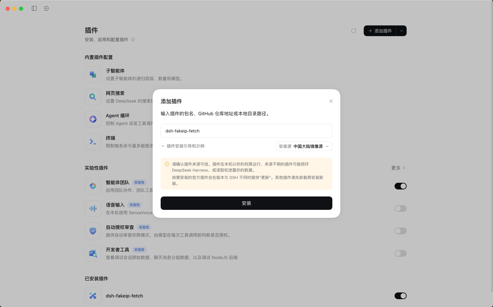
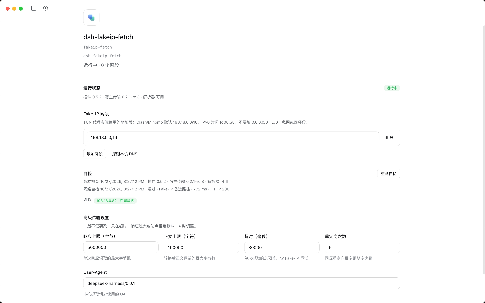

# dsh-fakeip-fetch

[](https://www.npmjs.com/package/dsh-fakeip-fetch)
[](https://github.com/Hariketsu/dsh-fakeip-fetch/actions/workflows/ci.yml)

[](LICENSE)

绕过 DSH 内置 WebFetch 对 Fake-IP 地址的 SSRF 限制，让本机 HTTP 抓取在 TUN Fake-IP 代理环境下正常工作。

## 为什么要用 dsh-fakeip-fetch？

| | DeepSeek 官方 Fetch API | 本地 fetch + 本插件 | 本地 fetch（无插件） |
| --- | --- | --- | --- |
| 抓取位置 | DeepSeek 服务端 | 本机 | 本机 |
| 网络出口 | 服务端网络 | 本机网络和代理 | 本机网络和代理 |
| TUN Fake-IP | 不受本机 Fake-IP 影响 | 支持配置的 Fake-IP 网段 | 在已验证的 DSH 版本中，Fake-IP 地址会被当作非公网地址拒绝 |
| 网页访问 | 取决于服务端网络 | 取决于本机网络和代理 | 取决于本机网络和代理；Fake-IP 模式下可能被拦截 |

## 官方 Fetch API 的访问情况

近期测试中 `POST /v1/tools/fetch` 的结果，反映的是当时的服务端出口。

| 目标                                                        | 测试结果                         |
| ----------------------------------------------------------- | -------------------------------- |
| `ipinfo.io`、`ifconfig.co`                                  | 返回中国大陆的华为云出口 IP      |
| `wikimediafoundation.org`、`dbpedia.org`                    | 可以抓取                         |
| Wikipedia、Google、X、YouTube、Reddit、BBC、NYT 等          | 返回 404                         |
| `raw.githubusercontent.com`、Hugging Face、`archive.org` 等 | 返回 404                         |
| Stack Overflow、npmjs、Reuters、AP 等                       | 等待约 13–30 秒后返回 404 或 504 |


## 安装和快速上手

### 从 npm 安装

在 DSH Desktop 的「插件」页面点击「添加插件」，输入 `dsh-fakeip-fetch` 并安装。



也可以使用 CLI 安装到指定 profile：

```bash
dsh plugin --profile <profile> add dsh-fakeip-fetch --ignore-scripts --config.auto-install-peers=false
```

### 从本地文件安装

在项目目录运行 `npm pack`，然后在 DSH 的「添加插件」窗口中输入生成的文件路径，例如：

```text
/path/to/dsh-fakeip-fetch-<version>.tgz
```

也可以通过 CLI 安装：

```bash
dsh plugin --profile <profile> add /path/to/dsh-fakeip-fetch-<version>.tgz \
  --ignore-scripts --config.auto-install-peers=false --store-dir <store>
```

### 配置和自检

1. 打开插件设置，确认 Fake-IP 网段与代理的实际配置一致；默认值为 `198.18.0.0/16`。
2. 使用「探测本机 DNS」查看当前解析结果，必要时修改网段并保存。
3. 查看「自检」结果；遇到问题时可以点击「重跑自检」。



设置页还提供超时、响应大小、重定向次数和 User-Agent 等传输设置。卸载插件后，内置的 HTTP provider 会恢复。

## 工作原理与兼容性

- DSH 的 HTTP provider 会将 Fake-IP 模式下解析到代理使用的虚拟地址视为非公网地址并拒绝请求。

- 使用 DSH 的 HTTP 传输实现，保留 TLS、同源重定向、超时和响应大小等限制。

- 依赖的地址解析器参数不是公开的插件 API：目前已在 DSH Desktop `0.2.1-rc.3`上测试，其他 DSH 版本或构建尚未验证。

- 针对 TUN Fake-IP 模式；使用 `redir-host` 模式时通常不需要它。跨源重定向沿用 DSH 的限制，需要直接请求目标 URL。

## 安全与网络行为

只填写代理实际使用的 Fake-IP 网段，不要填写私网、回环地址或 `0.0.0.0/0`、`::/0` 等宽泛网段：插件无法验证代理最终连接的地址。

首次启动或插件与宿主版本发生变化时，自检会查询 `en.wikipedia.org` 的 DNS，并尝试抓取 `https://example.com`；结果保存在 DSH 的本机存储中。设置页可手动触发 DNS 探测和重新自检。

## 常见问题

1. **提示 `cannot register the "http" fetch provider`**

当前 profile 中有另一个插件注册了 `http` provider。检查是否仍安装着 `dsh-local-fetch`，卸载后重启。

2. **提示地址不在配置的 Fake-IP 网段中**

检查代理的 Fake-IP 网段是否与插件设置一致。可以使用设置页的「探测本机 DNS」查看解析结果。

3. **自检显示 `resolver=unsupported`**

当前 DSH 构建不支持插件使用的地址解析器参数。插件会使用普通 HTTP 抓取，但无法处理 Fake-IP 地址。

## 开发

```bash
node --test test/policy.test.js
node test/client-bundle-check.mjs
```

集成测试使用 `test/driver.patch.yml` 和 `test/migration-check.patch.yml`；运行前需要将其中的路径替换为本机测试文件的绝对路径，并使用隔离的 DSH profile 和 `DSH_HOME`。

## 许可证

本项目由社区维护，与 DeepSeek 官方无关。

[MIT](LICENSE)
